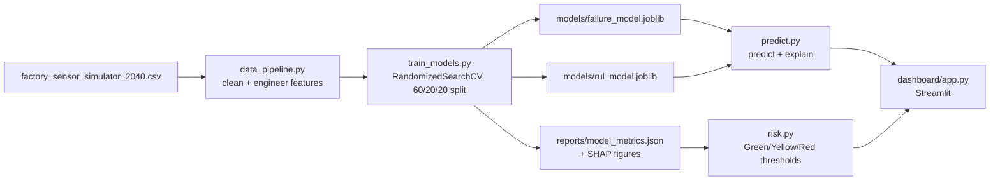

# 🏭 Industrial IoT Predictive Maintenance

[](https://github.com/varenyam/industrial-iot-predictive-maintenance/actions)
[](https://www.python.org/)
[](LICENSE)

An end-to-end machine learning system that predicts whether an industrial machine will **fail within 7 days**, estimates its **Remaining Useful Life (RUL)**, and surfaces both as a **Green / Yellow / Red condition-monitoring dashboard** across a fleet of 500,000 machines.

> Built as a portfolio project to demonstrate a realistic, production-shaped ML workflow: leakage-safe splits, hyperparameter tuning, validation-based decision thresholds (not a hard-coded 0.5), SHAP explainability, and a Streamlit app rather than just a notebook.

---

## Table of contents

- [Highlights](#highlights)
- [Dashboard](#dashboard)
- [Architecture](#architecture)
- [Project structure](#project-structure)
- [Setup](#setup)
- [Running the project](#running-the-project)
- [Modeling approach](#modeling-approach)
- [Results](#results)
- [Risk zones](#risk-zones)
- [Explainability](#explainability)
- [Testing & CI](#testing--ci)
- [Limitations & future work](#limitations--future-work)
- [Dataset / license](#dataset--license)

---

## Highlights

- **500,000** industrial machine records across **33 machine types**
- **11 engineered features** on top of the raw sensors (mechanical-efficiency ratios, fluid-health deficits, maintenance-load interactions, sensor-availability flags)
- Two `HistGradientBoosting` models (failure classification + RUL regression), each **tuned with `RandomizedSearchCV`** (3-fold CV) rather than hand-picked hyperparameters
- A proper **train / validation / test (60/20/20)** split - the test set is touched exactly once, at the end
- The classification **decision threshold is tuned on the validation set** (best-F1 and a high-precision alternative), not hard-coded at 0.5 — this alone lifts test F1 from **0.615 → 0.716**
- **SHAP** (TreeExplainer) explainability: global feature-importance charts in `reports/`, plus a live per-machine "why this prediction?" breakdown in the dashboard
- A **Streamlit dashboard** with three views: fleet-wide Green/Yellow/Red condition monitoring, a single-machine inspector with gauges and SHAP factors, and a model-insights tab with ROC/PR curves
- `pytest` unit tests for the data pipeline and risk-zone logic, wired into a **GitHub Actions CI** workflow

## Dashboard

The dashboard has three tabs:

**🚦 Fleet Overview** — every machine scored and bucketed into a condition zone:

| Zone | Meaning |
|---|---|
| 🟢 **Green** — Healthy | Low failure risk, comfortable RUL |
| 🟡 **Yellow** — Warning | Elevated failure risk or RUL dropping into a maintenance-planning window |
| 🔴 **Red** — Critical | High failure risk or very low RUL — schedule maintenance now |

Sortable/filterable table with zone-tinted rows, plus live counts of machines in each zone.

**🔍 Machine Inspector** — pick any machine and see:
- A colored zone badge
- Two gauges (failure probability, predicted RUL) shaded with the same Green/Yellow/Red bands used fleet-wide
- A SHAP bar chart showing the top factors pushing that specific machine's risk up or down, with the machine's actual sensor value labeled on each bar

**📊 Model Insights** — ROC curve, Precision-Recall curve, and global SHAP feature-importance charts for both models, plus the full metrics report.

## Architecture



`data_pipeline.py` is imported by both training and inference, so there is no train/serve skew — the exact same cleaning and feature-engineering logic runs in both places. `risk.py` reads its Green/Yellow/Red thresholds from the training run's validation-tuned decision threshold, so the dashboard and the model stay in sync whenever you retrain.

## Project structure

```text
industrial-iot-predictive-maintenance/
├── data/
│   ├── raw/factory_sensor_simulator_2040.csv
│   └── processed/
├── dashboard/
│   └── app.py                      # Streamlit app (3 tabs)
├── models/
│   ├── failure_model.joblib
│   └── rul_model.joblib
├── notebooks/
│   ├── 01_data_understanding.ipynb
│   ├── 02_data_preprocessing.ipynb
│   └── 03_model_training.ipynb
├── reports/
│   ├── model_metrics.json          # tuning, thresholds, test metrics, SHAP ranks
│   └── figures/                    # ROC, PR curve, SHAP importance charts
├── src/
│   ├── data_pipeline.py            # cleaning + feature engineering
│   ├── train_models.py             # tuning, validation threshold, SHAP, plots
│   ├── predict.py                  # predict() and explain() for inference
│   └── risk.py                     # shared Green/Yellow/Red logic
├── tests/
│   ├── test_data_pipeline.py
│   └── test_risk.py
├── .github/workflows/ci.yml
├── .gitignore
├── LICENSE
├── requirements.txt
└── README.md
```

## Setup

Recommended: Python 3.11+, VS Code, and the Python/Jupyter extensions.

```bash
python -m venv venv
source venv/bin/activate        # Windows: .\venv\Scripts\Activate.ps1
pip install -r requirements.txt
```

If PowerShell blocks activation:

```powershell
Set-ExecutionPolicy -Scope Process -ExecutionPolicy Bypass
.\venv\Scripts\Activate.ps1
```

The supplied CSV is already in `data/raw/`, so no separate dataset download is required.

## Running the project

Trained model artifacts are included, so you can jump straight to the dashboard. To retrain everything from scratch:

```bash
python src/train_models.py
```

This loads the raw data, cleans invalid sensor values, engineers features, splits into train/validation/test, runs `RandomizedSearchCV` for both models, tunes the classification threshold on the validation set, refits on train+validation, evaluates once on the untouched test set, computes SHAP importances, and writes everything to `models/` and `reports/`.

> **Runtime note:** the hyperparameter search runs on a 70k-row stratified subsample of the training split so it finishes in a few minutes on a laptop; the winning configuration is then refit on the full 400k-row train+validation set before anything is evaluated or saved. Increase `SHAP_SAMPLE_SIZE` or point the search at the full training set in `src/train_models.py` if you have more time/compute.

### Notebook workflow

1. `01_data_understanding.ipynb` — EDA and data quality
2. `02_data_preprocessing.ipynb` — cleaning, feature engineering, and splitting
3. `03_model_training.ipynb` — model training and evaluation

Select the project's `venv` as the Jupyter kernel.

### Dashboard

```bash
streamlit run dashboard/app.py
```

### Tests

```bash
pytest tests/ -v
```

## Modeling approach

| Step | Original | This version |
|---|---|---|
| Split | 80/20 train/test | 60/20/20 train/**validation**/test |
| Hyperparameters | Fixed, hand-picked | `RandomizedSearchCV`, 3-fold CV, 10 candidates |
| Decision threshold | Hard-coded 0.5 | Tuned on validation set (best-F1 + high-precision option) |
| Explainability | None | SHAP `TreeExplainer`, global + per-prediction |
| Feature set | 23 columns | 34 columns (+11 engineered) |
| Risk output | Raw probability/RUL only | Green/Yellow/Red zone, threshold-driven |

**Failure prediction** — target `Failure_Within_7_Days`, model `HistGradientBoostingClassifier`, balanced sample weights (failure is the minority class, ~6% of rows).

**RUL prediction** — target `Remaining_Useful_Life_days`, model `HistGradientBoostingRegressor`.

**Leakage prevention** — `Remaining_Useful_Life_days` is excluded from the failure model's inputs and `Failure_Within_7_Days` from the RUL model's inputs. `Machine_ID` is dropped (identifier, not predictive). The hyperparameter search and threshold tuning both happen on data the final test evaluation never sees.

**Engineered features** — beyond the original age/maintenance/sensor-stress features, this version adds: `Vibration_Power_Ratio` (mechanical inefficiency), `Fluid_Level_Deficit` (combined oil/coolant health), `Error_Rate_30d` and `AI_Override_Rate` (normalized instability signals), `Age_Overdue_Interaction` (compounding risk of old + overdue), and `Hours_Per_Maintenance` (usage intensity relative to service frequency).

## Results

Trained on the supplied 500,000-row dataset, `random_state=42`. Full detail (including confusion matrices and per-fold CV scores) is in `reports/model_metrics.json`.

**Failure model** (`HistGradientBoostingClassifier`, CV average precision `0.742 ± 0.017`):

| Threshold | Precision | Recall | F1 | Accuracy |
|---|---|---|---|---|
| 0.5 (default) | 0.449 | 0.975 | 0.615 | 0.927 |
| **0.894 (validation-tuned)** | **0.646** | **0.803** | **0.716** | **0.962** |

Test ROC-AUC: **0.983**. Tuning the threshold on the validation set trades a bit of recall for a large precision gain — fewer false alarms for roughly the same number of caught failures, which matters if every "Red" flag triggers a real maintenance dispatch.

**RUL model** (`HistGradientBoostingRegressor`, CV R² `0.972 ± 0.001`):

| Metric | Value |
|---|---|
| MAE | 38.06 days |
| RMSE | 48.22 days |
| R² | 0.972 |

**Top SHAP drivers** for both models: `Operational_Hours` dominates, followed by `Vibration_mms` and `Temperature_C` — consistent with the physical intuition that cumulative wear and elevated vibration/heat are the clearest failure signals. See `reports/figures/` for the full charts.

These results are dataset-specific and will change if the data, split, preprocessing, or hyperparameters change.

## Risk zones

Zones combine both model outputs — a machine is only as healthy as its worse signal:

```
Red    if failure_probability >= red_probability   OR  predicted_RUL <= 30 days
Yellow if failure_probability >= yellow_probability OR predicted_RUL <= 90 days
Green  otherwise
```

`red_probability` and `yellow_probability` are the high-precision and best-F1 thresholds picked on the validation set during training (not arbitrary constants) — see `reports/model_metrics.json → risk_zone_thresholds`. The 30/90-day RUL cutoffs are fixed maintenance-planning assumptions and can be adjusted in `src/risk.py`.

## Explainability

`src/predict.py::explain()` runs SHAP `TreeExplainer` on the fitted model for any row(s) you pass in, returning the top contributing features with their SHAP values and the machine's actual sensor readings. The dashboard's Machine Inspector tab renders this live for whichever machine you select — red bars push risk up, green bars push it down.

## Testing & CI

`tests/` covers the data pipeline (invalid-value handling, missing-value imputation, feature engineering, leakage exclusion) and the risk-zone classification logic. `.github/workflows/ci.yml` runs the full suite on every push/PR across Python 3.11 and 3.12.

## Limitations & future work

- The hyperparameter search subsamples the training data for speed; a full-data search (or a proper Optuna/Bayesian search) would likely find a better configuration.
- RUL MAE of ~38 days is large in absolute terms — a monotonic or survival-analysis model (e.g. gradient-boosted Cox, or `lightgbm` with a Tweedie/quantile objective) might better capture the right-skewed RUL distribution.
- Risk-zone thresholds are shared globally; per-machine-type thresholds (a chiller and a mixer may have different failure-cost profiles) would be a natural next step.
- No time-series structure is exploited — each row is treated as an independent snapshot, so trend/rate-of-change features (e.g. vibration slope over the last N readings) aren't available with this dataset's schema.
- The dashboard fits comfortably for exploration but batch-scores the whole CSV on load; a real deployment would persist scores and refresh incrementally.

## Dataset / license

Code is MIT-licensed (see `LICENSE`) and intended for educational/portfolio use. Check the original dataset's license and redistribution terms before publishing the CSV publicly.

The raw CSV is about 49 MB — under GitHub's per-file limit but large for a git repo. For a lighter clone, consider Git LFS or linking to the original dataset instead of committing the CSV. Do not commit `venv/`.
